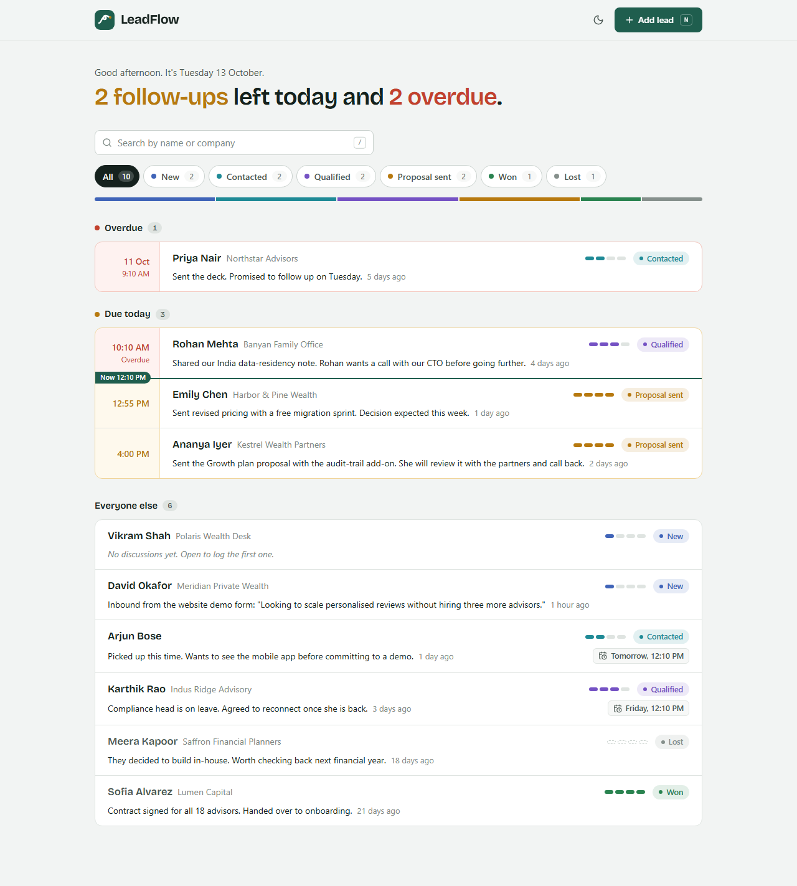
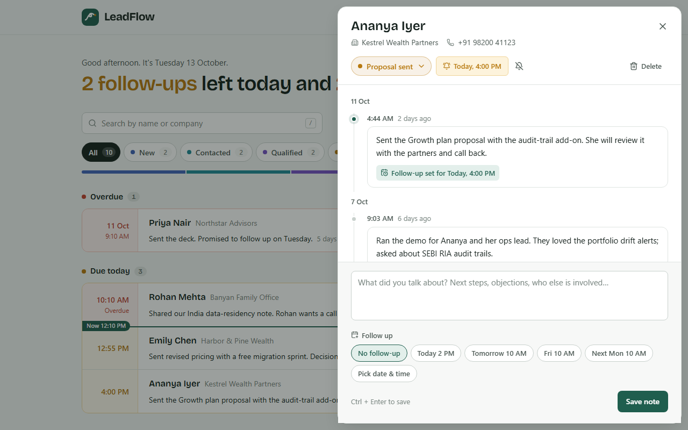
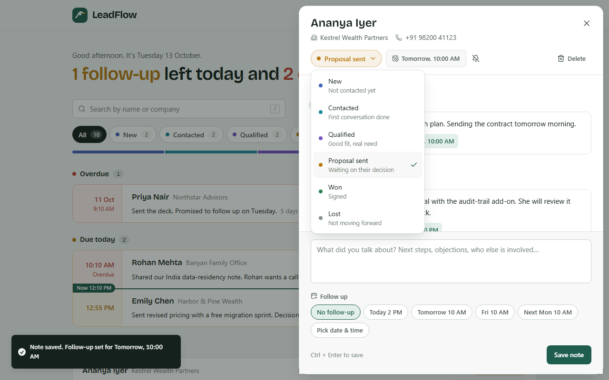
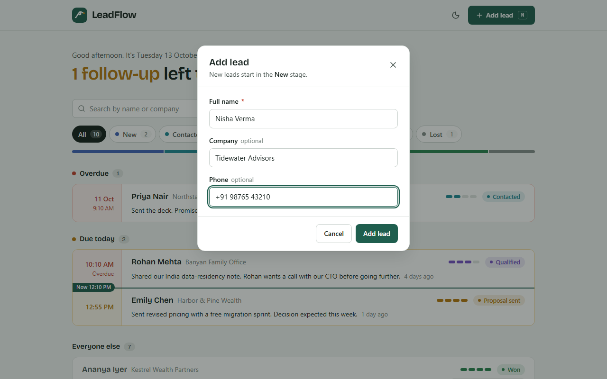
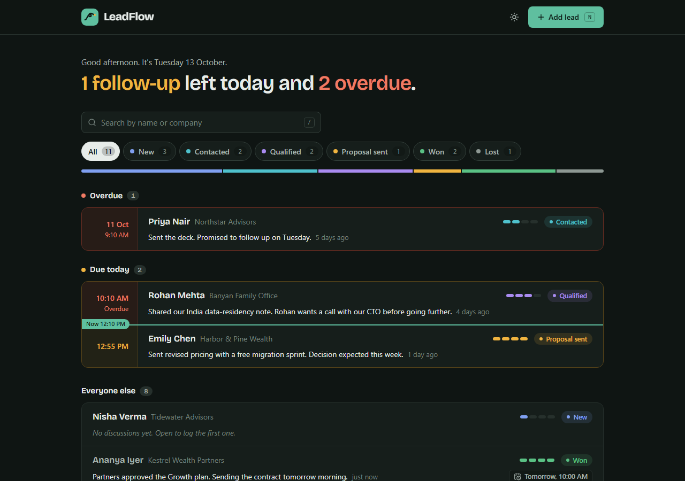
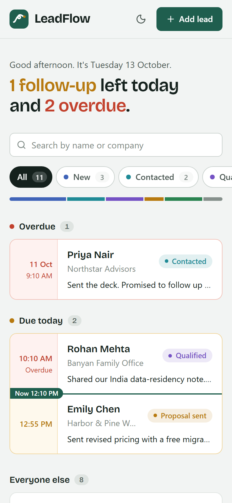

# LeadFlow

[](https://github.com/Mohil-Ahuja/leadflow/actions/workflows/ci.yml)

A single-screen lead manager for a sales rep: see who to call today, log every conversation, and set the next follow-up without leaving the list.

Built with **Next.js 15 + FastAPI** for the Pravar AI full-stack internship assignment.


> Full-quality recording: [`docs/demo.mp4`](docs/demo.mp4)

| Lead list | Timeline dialog |
| --- | --- |
|  |  |
| **Status picker** | **Add lead** |
|  |  |
| **Dark mode** | **Mobile** |
|  |  |

---

## Quick start

### Option A: Docker Compose (Postgres + API + web)

```bash
cp .env.example .env        # optional: every value has a default; set TZ to your timezone
docker compose up --build
```

Open **http://localhost:3000**. The API is on http://localhost:8000 (interactive docs at `/docs`). An empty database is seeded with 10 demo leads on first start.

### Option B: Run locally (SQLite, no Docker)

Requirements: Python 3.11+ and Node 20+.

**1. Backend** (terminal 1)

```bash
cd backend
python -m venv .venv
# Windows: .venv\Scripts\activate    macOS/Linux: source .venv/bin/activate
pip install -r requirements-dev.txt
cp .env.example .env
python -m app.seed               # 10 demo leads with discussion history
uvicorn app.main:app --reload --port 8000
```

**2. Frontend** (terminal 2)

```bash
cd frontend
npm install
cp .env.example .env.local
npm run dev
```

Open **http://localhost:3000**.

The seed data is relative to the moment you run it, so there are always follow-ups due today, one overdue and some coming up. Run `python -m app.seed --reset` to start fresh.

### Tests

```bash
cd backend && pytest            # 23 API tests, each against a fresh in-memory database
cd frontend && npm test         # unit tests for the follow-up grouping and date logic
cd frontend && npm run lint && npx tsc --noEmit
python e2e/flow.py              # browser flow test (needs Playwright and both servers running on freshly seeded data)
```

---

## What's in it

### The brief, point by point

| Requirement | Where it lives |
| --- | --- |
| List shows name, status, last note, time since last discussion | `LeadRow`: the "last note" is the latest note the rep wrote (automatic entries like status changes are skipped), with a live "2 hours ago" |
| Filter by status (all six) | `PipelineFilter`: also shows the count in each stage and a bar of how leads are spread across the pipeline |
| Today's follow-ups pinned at the top | `Agenda` + `groupLeads()`: today's follow-ups sorted by time, using the **viewer's** timezone, with a "Now" line between what's already due and what's still to come |
| Click a lead → dialog, not a new page | `LeadDialog`: an accessible Radix dialog shown as a side panel, so the list stays visible behind it |
| History in reverse chronological order | Sorted by the API (`created_at DESC, id DESC`), grouped by day in the UI |
| Add a note + optional follow-up date & time | `Composer`: one-click presets (*Today 4 PM*, *Tomorrow 10 AM*, *Fri 10 AM*, *Next Mon 10 AM*) or a custom date and time; Ctrl+Enter saves |
| Follow-up updates the lead and shows in the list immediately | The API returns the updated lead with the new note; the client writes it into every cached list straight away, then refetches |
| Update status from the dialog | `StatusSelect`: saved right away, recorded in the timeline ("Status changed from New to Contacted"), and can be undone from the toast |
| Add a new lead (name required; company and phone optional; status New) | `AddLeadDialog`: checked in the browser and on the server, with field-level errors |

### Bonus items

- **Search by name** (and company): searched on the server, typed input is debounced, press `/` to focus
- **Overdue follow-ups in red**: earlier days sit in their own *Overdue* group; today's that have passed turn red inside *Due today*
- **Docker Compose** with Postgres, health checks and auto-seeding. CI starts the whole stack on every push and tests it through the web app
- **Seed script** with 10 leads and 20+ logged discussions (`python -m app.seed`)
- **Filters**: status filter and search work together, with counts per stage

### Extras

- **The headline sums up the day.** *"2 follow-ups left today and 1 overdue."* That's what a rep wants to know first.
- **Stage meter:** four ticks next to each lead show how far along the pipeline the deal is; won fills them all, lost leaves them dashed.
- **Clear a follow-up** from the dialog, and **delete a lead** (it asks you to click twice; no browser pop-up).
- **Keyboard:** `N` adds a lead, `/` searches, `Esc` closes, `Ctrl+Enter` saves a note.
- **Light and dark themes** (follows your system setting, with a toggle), works at phone width, keyboard-accessible dialogs and a visible focus ring, respects reduced motion.
- **Times stay current:** "time ago", the Now line and overdue states refresh every 30 seconds without reloading the page.

---

## Architecture

```
leadflow/
├── backend/                 FastAPI + SQLAlchemy 2.0
│   ├── app/
│   │   ├── main.py          app factory, CORS, lifespan (create tables, optional seed)
│   │   ├── config.py        settings from env (pydantic-settings)
│   │   ├── database.py      engine, session, UTC-aware DateTime type
│   │   ├── models.py        Lead, Discussion, LeadStatus, DiscussionKind
│   │   ├── schemas.py       request/response models with input clean-up
│   │   ├── services.py      business logic: queries, follow-up rules, status log
│   │   ├── routers/leads.py thin HTTP layer
│   │   ├── errors.py        one JSON error format for every failure
│   │   └── seed.py          demo data
│   └── tests/
├── frontend/                Next.js 15 (App Router) + TypeScript + Tailwind v4
│   └── src/
│       ├── app/             layout, fonts, theme tokens, providers
│       ├── lib/             api client, React Query hooks, time/grouping logic (+ tests)
│       └── components/      list, agenda, filter, dialogs (lead-dialog/ split into parts)
├── docker-compose.yml
└── docs/                    screenshots and demo video
```

**How data flows.** The browser only ever calls `/api/*` on its own origin. Next.js forwards those requests to FastAPI (`rewrites` in `next.config.ts`), so local development needs no CORS setup and Docker can reach the API by its service name. TanStack Query caches the data. Every change patches the updated lead into the cached lists, so the UI updates immediately, then refetches to get the counts and history.

**Time zones.** Times are stored in UTC, and the API only accepts follow-up times that include a timezone offset. "Today" is worked out in the browser in the viewer's own timezone. That decision lives in one pure function, `groupLeads()`, which is unit-tested.

### API

| Method | Path | Success | Errors |
| --- | --- | --- | --- |
| `GET` | `/api/leads?status=&q=` | `200` `{items, total, status_counts}` | `422` bad status |
| `POST` | `/api/leads` | `201` + `Location` header | `422` |
| `GET` | `/api/leads/{id}` | `200` | `404` |
| `PATCH` | `/api/leads/{id}` | `200` (partial; `"follow_up_at": null` clears it) | `404`, `422` |
| `DELETE` | `/api/leads/{id}` | `204` | `404` |
| `GET` | `/api/leads/{id}/discussions` | `200` newest first | `404` |
| `POST` | `/api/leads/{id}/discussions` | `201` `{discussion, lead}` | `404`, `422` |
| `GET` | `/api/health` | `200` | |

Every error uses the same shape, so the UI can show a message next to the right field:

```json
{
  "error": {
    "code": "validation_error",
    "message": "follow_up_at: Pick a follow-up time in the future",
    "details": [{ "field": "follow_up_at", "message": "Pick a follow-up time in the future" }]
  }
}
```

Unexpected exceptions are logged and returned as a generic `500` that doesn't expose internals.

### Decisions worth calling out

- **A note without a follow-up keeps the existing one.** Logging "left a voicemail" shouldn't silently cancel Thursday's call. Clearing a follow-up is a separate, explicit action.
- **Follow-ups can't be set in the past** (there's a 5-minute allowance for slow typing). This is checked in the form and enforced by the API.
- **Overdue follow-ups from earlier days are pinned too, above today's.** The brief asks for today's follow-ups to be pinned. A follow-up missed yesterday needs attention even more, so it gets its own red group rather than sinking into the full list.
- **Status changes are written to the timeline** as automatic entries, so the history explains how a deal moved. They never replace the "last note" shown in the list.
- **No login.** The brief marks it optional. I spent that time on the core flows, tests and polish.
- **No migrations tool.** Tables are created on startup. For a real deployment I'd add Alembic.

---

## Use of AI

As the brief encouraged, I built this with an AI coding assistant. To be clear about how:

- **AI-assisted:** I set the brief and direction; the assistant proposed and wrote most of the design and code, the test cases, the seed data copy, the Dockerfiles and this README.
- **How it was checked:** the backend tests (23) and frontend unit tests pass, and CI runs them on every push along with a Docker Compose smoke test; type checks and lint are clean; and the main flows were run end to end in a real browser with Playwright: logging a note with a follow-up, changing status, adding a lead, search, filters and reloading to confirm changes are saved. The screenshots and the demo video come from those runs.
- I reviewed the output and can walk through and defend any part of it in a follow-up conversation.

## What I'd do next

- Log in with a separate lead list for each rep
- Alembic migrations, and pagination once the list grows
- Browser notifications when a follow-up comes due
- Run the Playwright browser flow in CI as well
